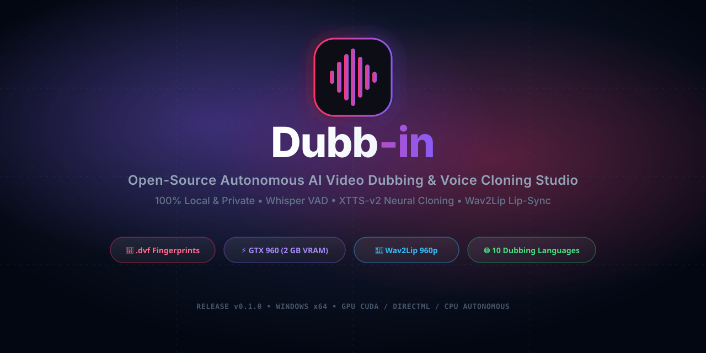
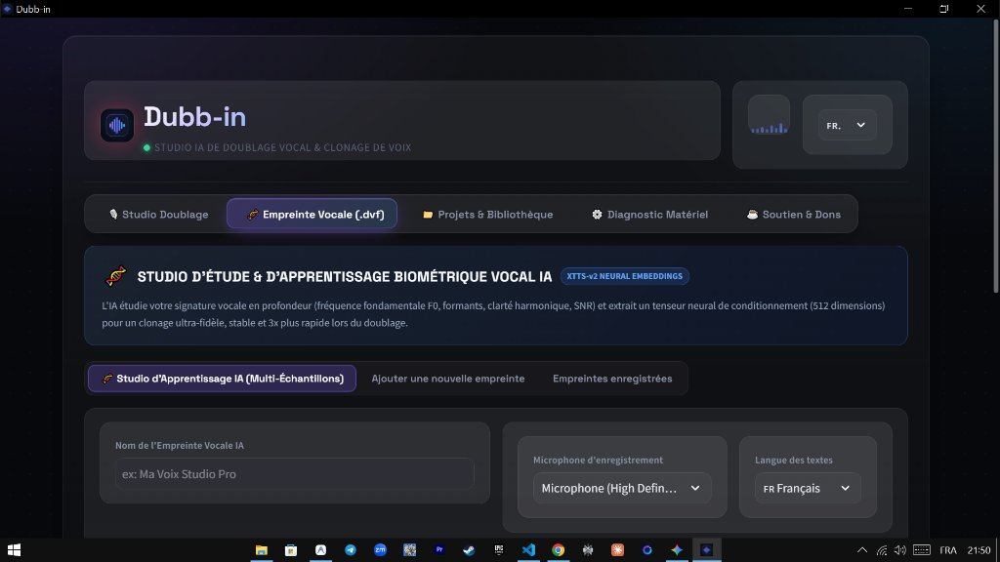
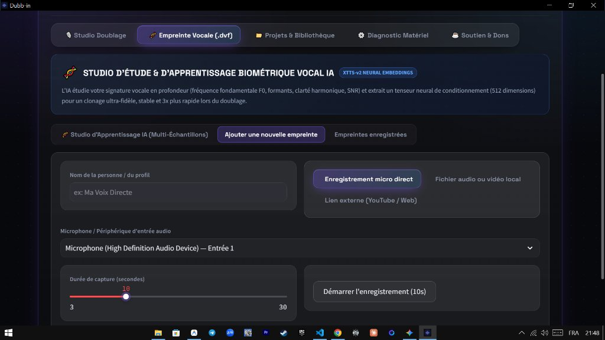
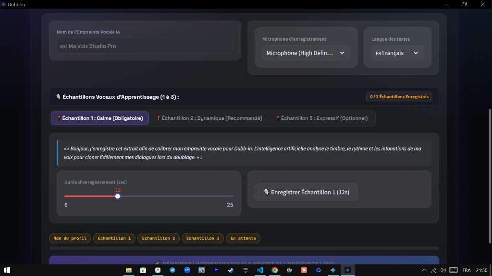
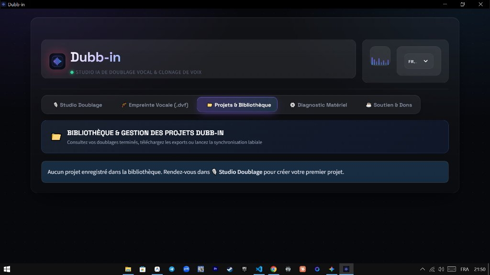

<p align="center">
  
</p>

<p align="center">
  <strong>Studio IA Autonome de Doublage Vidéo &amp; de Clonage Vocal Neuronal</strong><br>
  <em>100% Local, Hors-Ligne &amp; Privé — Zéro Abonnement, Zéro API Cloud, Souveraineté Totale</em>
</p>

<p align="center">
  <a href="https://www.python.org/downloads/release/python-31011/"></a>
  <a href="https://streamlit.io/"></a>
  <a href="https://pytorch.org/"></a>
  <a href="LICENSE"></a>
  <a href="#configuration-matérielle-requise"></a>
  <a href="README.md"></a>
</p>

---

## 🌟 Présentation

**Dubb-in** est un studio de bureau open-source autonome permettant de doubler automatiquement des vidéos dans plusieurs langues avec **clonage vocal ultra-fidèle de l'orateur** et **synchronisation labiale (lip-sync)** par intelligence artificielle.

Conçu pour les créateurs de contenu, formateurs et cinéastes indépendants, Dubb-in fonctionne **intégralement sur votre ordinateur personnel**. Grâce à une gestion chirurgicale de la mémoire vidéo (VRAM), l'application exécute des modèles neuronaux de pointe même sur des cartes graphiques modestes, avec un minimum testé de **2 Go de VRAM (NVIDIA GeForce GTX 960)**.

<p align="center">
  
</p>

---

## 📸 Aperçu & Captures d'Écran

<table align="center">
  <tr>
    <td width="50%">
      <p align="center"><strong>Studio Doublage (Création de projet &amp; Pipeline)</strong></p>
      
    </td>
    <td width="50%">
      <p align="center"><strong>Empreinte Vocale (.dvf Calibrage Biométrique)</strong></p>
      
    </td>
  </tr>
  <tr>
    <td width="50%">
      <p align="center"><strong>Bibliothèque de Projets &amp; Lecteur Vidéo</strong></p>
      
    </td>
    <td width="50%">
      <p align="center"><strong>Diagnostic Matériel &amp; Surveillance VRAM en Direct</strong></p>
      
    </td>
  </tr>
</table>

---

## ✨ Fonctionnalités Majeures

- 🎙️ **Empreintes Vocales Neuronales (`.dvf`)** :
  - Extraction de tenseurs de conditionnement (512 dimensions), calcul du F0 fondamental et analyse harmonique dans un format unifié et portable `.dvf`.
  - Téléprompteur interactif d'apprentissage en 3 échantillons pour une résonance vocale optimale.
- ⚡ **Optimisation VRAM Extrême (2 Go VRAM)** :
  - Orchestration séquentielle et déchargement systématique de la VRAM (`gc.collect()` + vidage cache PyTorch CUDA).
  - Exécution fluide sur **GTX 960 (2 Go VRAM)** en demi-précision FP16.
- 🗣️ **Reconnaissance Vocale & VAD (Faster-Whisper)** :
  - Détection précise de l'activité vocale (Silero VAD) avec horodatage strict et segmentation temporelle.
- 🌐 **10 Langues de Doublage Prises en Charge** :
  - Traduction et adaptation phonétique : Français, Anglais, Espagnol, Allemand, Italien, Portugais, Chinois, Japonais, Arabe et Russe.
- 👄 **Module Lip-Sync Autonome (Wav2Lip ONNX)** :
  - Détection faciale YuNet ultra-légère et inférence ONNX Runtime.
  - Lissage temporel EMA et masque adouci par cosinus sous Numba pour éliminer tout artefact visuel.
- 🎶 **Séparation des Pistes Audio (Demucs)** :
  - Conservation intégrale de la musique de fond et des effets sonores (SFX / Foley).
- 🖥️ **Application Autonome Windows** :
  - Fenêtre de bureau native indépendante (`Dubb-in.exe` via PyWebview) ne nécessitant aucun navigateur.

---

## 🖥️ Configuration Matérielle Requise

| Composant | Configuration Minimale Testée | Configuration Recommandée |
| :--- | :--- | :--- |
| **GPU** | **NVIDIA GeForce GTX 960 (2 Go VRAM)** | NVIDIA RTX 3060 / 4060 (6 Go+ VRAM) |
| **CUDA** | CUDA 11.8 / 12.1 ou DirectML | CUDA 12.x avec accélération cuDNN |
| **CPU** | Intel Core i5 (4e Gén.) / AMD Ryzen 3 | Intel Core i7 (10e Gén.+) / Ryzen 7 |
| **RAM** | 8 Go de mémoire système | 16 Go de mémoire système |
| **Disque** | 10 Go d'espace libre (SSD conseillé) | 25 Go d'espace libre (SSD NVMe) |
| **Système** | Windows 10 / 11 (64-bit) | Windows 11 (64-bit) |

---

## 🚀 Installation Rapide

Installez et lancez Dubb-in en **5 commandes simples** :

```bash
# 1. Cloner le dépôt
git clone https://github.com/PapyTechnologies/dubb-in.git
cd dubb-in

# 2. Exécuter l'installateur automatisé Windows (configure Python 3.10, PyTorch CUDA et FFmpeg)
installer_windows.bat
```

*Procédure manuelle alternative :*

```bash
# 1. Créer l'environnement virtuel
py -3.10 -m venv .venv
.venv\Scripts\activate

# 2. Installer PyTorch avec accélération CUDA 11.8
pip install torch==2.2.2+cu118 torchvision==0.17.2+cu118 torchaudio==2.2.2+cu118 --index-url https://download.pytorch.org/whl/cu118

# 3. Installer les dépendances
pip install -r requirements.txt

# 4. Lancer l'application autonome
python window.py
```

---

## 📖 Guide d'Utilisation Étape par Étape

### Étape 1 : Créer une Empreinte Vocale (`.dvf`)
1. Rendez-vous dans l'onglet **🧬 Empreinte Vocale (.dvf)**.
2. Choisissez votre microphone dans le **Studio d'Apprentissage IA**.
3. Enregistrez les 3 échantillons calibrés affichés sur le téléprompteur :
   - *Échantillon 1 (Calme)* : Fréquence fondamentale F0 de base.
   - *Échantillon 2 (Dynamique)* : Clarté harmonique et rythme d'élocution.
   - *Échantillon 3 (Expressif)* : Variabilité de hauteur et dynamique tonale.
4. Cliquez sur **Démarrer l'apprentissage IA & Export (.dvf)** pour sauvegarder votre empreinte.

### Étape 2 : Doubler une Vidéo
1. Ouvrez l'onglet **🎙️ Studio Doublage**.
2. Glissez votre vidéo source ou collez un lien YouTube/Web.
3. Sélectionnez votre empreinte vocale enregistrée dans le menu déroulant.
4. Choisissez la langue de sortie et cliquez sur **Créer le projet & Analyser la vidéo**.

### Étape 3 : Synchronisation Labiale (Lip-Sync) & Export
1. Visionnez le résultat dans **Projets & Bibliothèque**.
2. Déclenchez la passe **Lip-Sync IA** pour aligner le mouvement des lèvres sur la voix doublée.
3. Téléchargez la vidéo masterisée finale avec incrustation optionnelle des sous-titres.

---

## ⚖️ Licences Tierces & Avertissement Éthique

### Charte d'Utilisation Éthique
Dubb-in est conçu pour la création légitime, la localisation linguistique et l'accessibilité :
- **Consentement Vocal Obligatoire** : Il est formellement interdit de cloner la voix d'une personne sans son consentement explicite et vérifiable.
- **Usages Proscrits** : L'usurpation d'identité, les deepfakes frauduleux, la désinformation politique ou toute utilisation biométrique abusive sont strictement interdits.
- **Responsabilité** : L'utilisateur assume l'entière responsabilité légale et morale des contenus produits.

### Licences des Modèles Tiers
- **Faster-Whisper** : [Licence MIT](https://github.com/SYSTRAN/faster-whisper/blob/master/LICENSE) (OpenAI Whisper / CTranslate2).
- **Coqui XTTS-v2** : [Coqui Public Model License (CPML)](https://coqui.ai/cpml) — Usage exclusivement **Non-Commercial**.
- **Wav2Lip** : [Licence Académique & Recherche Non-Commerciale](https://github.com/Rudrabha/Wav2Lip/blob/master/LICENSE).
- **Demucs** : [Licence MIT](https://github.com/facebookresearch/demucs/blob/main/LICENSE) (Meta AI Research).
- **PyTorch** : [Licence BSD Modifiée](https://github.com/pytorch/pytorch/blob/main/LICENSE).
- **Streamlit** : [Licence Apache 2.0](https://github.com/streamlit/streamlit/blob/develop/LICENSE).

---

## ☕ Soutien & Dons

Dubb-in est développé de façon 100% indépendante et gratuite. Si ce logiciel vous est utile, vous pouvez soutenir son créateur :

- **GitHub Sponsors** : [PapyTechnologies](https://github.com/sponsors/PapyTechnologies)
- **Ko-fi** : [ko-fi.com/papytech](https://ko-fi.com/papytech)
- **Buy Me a Coffee** : [buymeacoffee.com/papytech](https://buymeacoffee.com/papytech)
- **PayPal** : [Faire un don via PayPal](https://www.paypal.com/ncp/payment/7WFU8JE3FA6PG)

---

## 📄 Licence du Projet

Le code source de Dubb-in est distribué sous licence **[GNU General Public License v3.0 (GPL-3.0)](LICENSE)**.  
*Les poids des modèles neuronaux sous-jacents (XTTS-v2 et Wav2Lip) restent régis par leurs licences non-commerciales respectives.*
