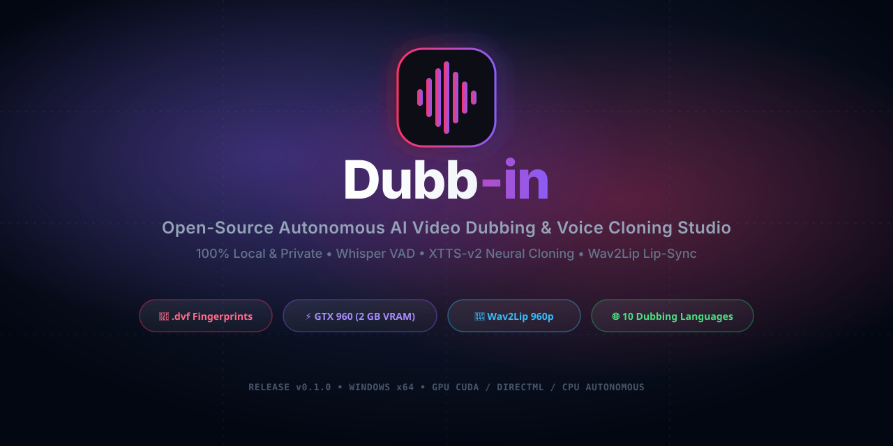
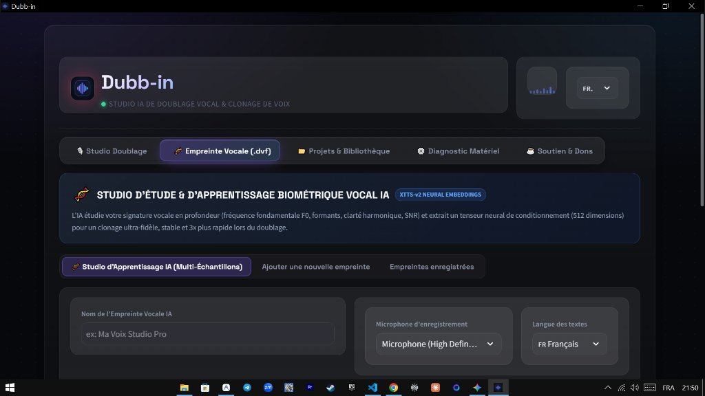
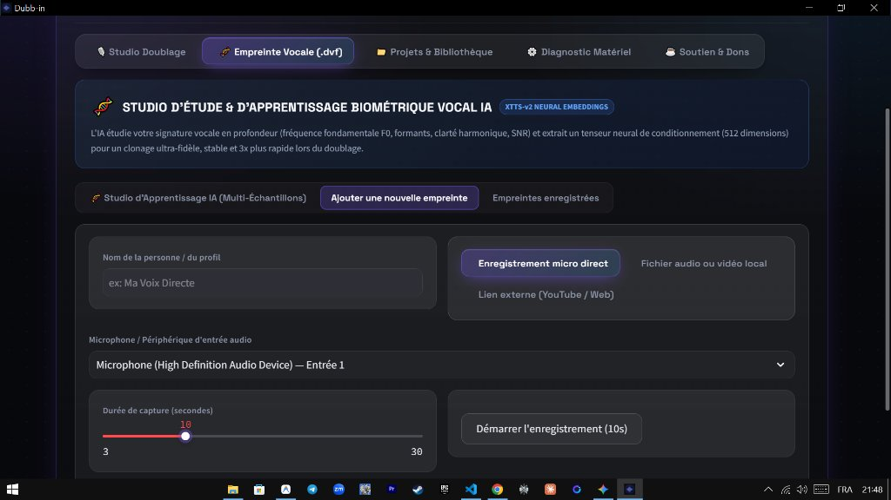
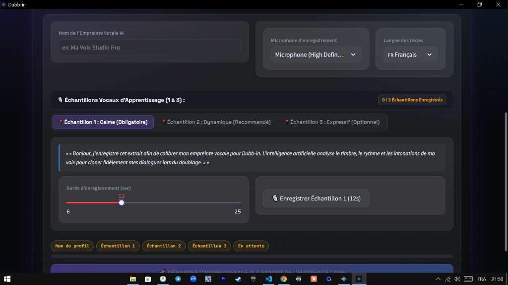
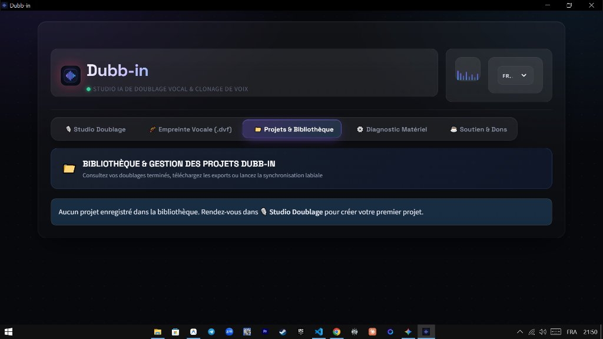
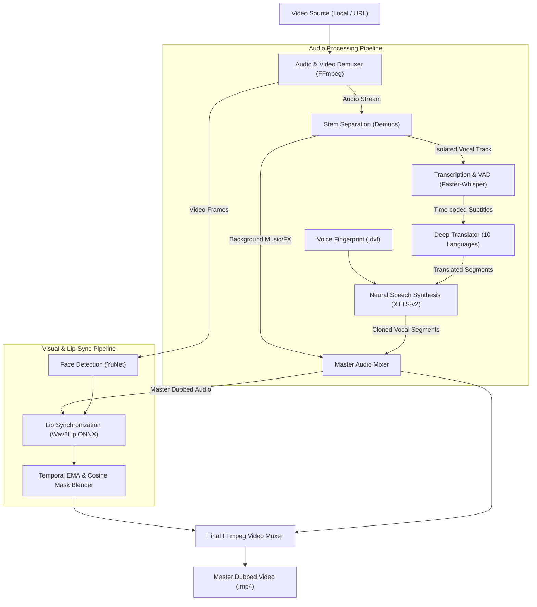

<p align="center">
  
</p>

<p align="center">
  <strong>Autonomous AI Video Dubbing &amp; Neural Voice Cloning Studio</strong><br>
  <em>100% Local, Offline &amp; Private — Zero Subscriptions, Zero Cloud APIs, Sovereignty Preserved</em>
</p>

<p align="center">
  <a href="https://www.python.org/downloads/release/python-31011/"></a>
  <a href="https://streamlit.io/"></a>
  <a href="https://pytorch.org/"></a>
  <a href="LICENSE"></a>
  <a href="#hardware-requirements"></a>
  <a href="README.fr.md"></a>
</p>

---

## 🌟 Overview

**Dubb-in** is an open-source, production-ready desktop studio designed to automatically dub videos into multiple languages with **exact speaker voice cloning** and **AI-driven lip synchronization**. 

Engineered specifically for creators, educators, and indie filmmakers, Dubb-in operates **entirely on your local PC**. It features breakthrough VRAM management that enables state-of-the-art neural models to execute efficiently on entry-level GPUs — including configurations with as little as **2 GB VRAM (tested on an NVIDIA GeForce GTX 960)**.

<p align="center">
  
</p>

---

## 📸 Screenshots & Interface

<table align="center">
  <tr>
    <td width="50%">
      <p align="center"><strong>Studio Doublage (Dashboard &amp; Pipeline)</strong></p>
      
    </td>
    <td width="50%">
      <p align="center"><strong>Voice Fingerprint (.dvf Biometric Calibration)</strong></p>
      
    </td>
  </tr>
  <tr>
    <td width="50%">
      <p align="center"><strong>Project Library &amp; Video Review</strong></p>
      
    </td>
    <td width="50%">
      <p align="center"><strong>Real-Time Hardware Diagnostic &amp; VRAM</strong></p>
      
    </td>
  </tr>
</table>

---

## ✨ Key Features

- 🎙️ **Proprietary Voice Fingerprints (`.dvf`)**:
  - Encapsulates 512-dimensional XTTS speaker latents, F0 fundamental pitch statistics, and harmonic spectral profiles into a standalone portable file.
  - Guided 3-sample calibration teleprompter for optimal vocal resonance.
- ⚡ **Ultra-Low VRAM Optimization**:
  - Sequential pipeline orchestration with aggressive VRAM offloading (`gc.collect()` + `torch.cuda.empty_cache()`).
  - Successfully executes on **GTX 960 (2 GB VRAM)** via FP16 mixed-precision and tiled processing.
- 🗣️ **Faster-Whisper Speech Recognition & VAD**:
  - Integrated Voice Activity Detection (Silero VAD) with millisecond timestamp alignment and word-level segmentation.
- 🌐 **10 Supported Target Languages**:
  - Full translation and localized phoneme adaptation: English, French, Spanish, German, Italian, Portuguese, Chinese, Japanese, Arabic, and Russian.
- 👄 **Autonomous Lip-Sync Engine (Wav2Lip ONNX)**:
  - Lightweight YuNet face tracking combined with ONNX Runtime acceleration.
  - Numba-optimized temporal EMA filtering and cosine edge-feathering to eliminate mouth box artifacts.
- 🎶 **Stem Audio Isolation (Demucs)**:
  - Preserves background music, sound effects, and ambient Foley while replacing dialogue cleanly.
- 🖥️ **Dual Run Modes**:
  - **Native Window Desktop App**: Zero-browser standalone shell (`Dubb-in.exe` via PyWebview).
  - **Web Studio**: Streamlit reactive browser mode accessible across local networks.

---

## 🖥️ Hardware Requirements

| Component | Minimum Tested Specification | Recommended Specification |
| :--- | :--- | :--- |
| **GPU** | **NVIDIA GeForce GTX 960 (2 GB VRAM)** | NVIDIA RTX 3060 / 4060 (6 GB+ VRAM) |
| **CUDA** | CUDA 11.8 / 12.1 or DirectML fallback | CUDA 12.x with cuDNN acceleration |
| **CPU** | Intel Core i5 (4th Gen) / AMD Ryzen 3 | Intel Core i7 (10th Gen+) / Ryzen 7 |
| **RAM** | 8 GB System Memory | 16 GB System Memory |
| **Storage** | 10 GB free space (SSD recommended) | 25 GB free space (NVMe SSD) |
| **OS** | Windows 10 / 11 (64-bit) | Windows 11 (64-bit) |

> [!NOTE]
> When executing on a 2 GB VRAM GPU, Dubb-in automatically schedules memory offloads between Whisper transcription and XTTS-v2 inference.

---

## 🚀 Quickstart Installation

You can get Dubb-in running locally with **5 simple commands**:

```bash
# 1. Clone the repository
git clone https://github.com/PapyTechnologies/dubb-in.git
cd dubb-in

# 2. Run the automated Windows installer (sets up Python 3.10 venv, PyTorch CUDA, and FFmpeg)
installer_windows.bat
```

*Manual Installation Alternative:*

```bash
# 1. Create virtual environment
py -3.10 -m venv .venv
.venv\Scripts\activate

# 2. Install PyTorch with CUDA 11.8 support
pip install torch==2.2.2+cu118 torchvision==0.17.2+cu118 torchaudio==2.2.2+cu118 --index-url https://download.pytorch.org/whl/cu118

# 3. Install core dependencies
pip install -r requirements.txt

# 4. Launch Dubb-in native desktop window
python window.py
```

---

## 📖 Step-by-Step Usage Guide

### Step 1: Create a Voice Fingerprint (`.dvf`)
1. Open the **🧬 Empreinte Vocale (.dvf)** tab.
2. Select your microphone and language in the **Studio d'Apprentissage IA**.
3. Read the three guided calibration prompts displayed on the teleprompter:
   - *Sample 1 (Calm)*: Base pitch and fundamental F0 frequency.
   - *Sample 2 (Dynamic)*: Harmonic clarity and vocal cadence.
   - *Sample 3 (Expressive)*: Pitch variability and dynamic range.
4. Click **Démarrer l'apprentissage IA & Export (.dvf)**. Your certified voice fingerprint is stored locally.

### Step 2: Dub a Video
1. Switch to **🎙️ Studio Doublage**.
2. Select your source video (MP4, MOV, MKV, or YouTube URL).
3. Select your saved Voice Fingerprint from the dropdown list.
4. Pick your output language and click **Créer le projet & Analyser la vidéo**.
5. The pipeline automatically:
   - Extracts and isolates speech with Faster-Whisper.
   - Translates lines while preserving time codes.
   - Synthesizes cloned speech via XTTS-v2.
   - Merges dialogue over the isolated background music track.

### Step 3: Lip-Syncing & Video Export
1. View the real-time player in **Projets & Bibliothèque**.
2. Trigger the **AI Lip-Sync** pass to align speaker mouth movements with the newly generated dialogue.
3. Export the final mastered video file (H.264 / AAC) with optional subtitle burn-in.

---

## 🏗️ Architecture



---

## ⚖️ Third-Party Licenses & Ethical Notice on Voice Cloning

### Ethical Statement & Responsible AI
Dubb-in is created to empower legitimate creative work, multilingual localization, and accessibility. 
- **Voice Consent**: It is strictly forbidden to clone any individual's voice without explicit, verifiable authorization.
- **Prohibited Use**: Impersonation, unauthorized deepfakes, financial fraud, hate speech, political manipulation, or non-consensual biometric processing are strictly prohibited.
- **User Accountability**: The operator assumes full legal and ethical responsibility for the content generated using this software.

### Third-Party Component Licenses
Dubb-in utilizes open-source AI models and dependencies governed by their respective licenses:
- **Faster-Whisper**: [MIT License](https://github.com/SYSTRAN/faster-whisper/blob/master/LICENSE) (OpenAI Whisper / CTranslate2).
- **Coqui XTTS-v2**: [Coqui Public Model License (CPML)](https://coqui.ai/cpml). Strictly restricted to **Non-Commercial** usage.
- **Wav2Lip**: [Academic & Research Non-Commercial License](https://github.com/Rudrabha/Wav2Lip/blob/master/LICENSE).
- **Demucs**: [MIT License](https://github.com/facebookresearch/demucs/blob/main/LICENSE) (Meta AI Research).
- **PyTorch**: [Modified BSD License](https://github.com/pytorch/pytorch/blob/main/LICENSE).
- **Streamlit**: [Apache License 2.0](https://github.com/streamlit/streamlit/blob/develop/LICENSE).

---

## 🗺️ Roadmap

- [x] Initial release (v0.1.0) with XTTS-v2, Faster-Whisper, and Wav2Lip ONNX.
- [x] Multi-sample `.dvf` biometric fingerprinting with teleprompter.
- [x] Full offline Windows desktop application wrapper.
- [ ] Multi-speaker diarization (automatic voice matching for multiple interlocutors).
- [ ] CUDA TensorRT engine for 2x faster lip-sync throughput.
- [ ] Direct Linux / macOS installer scripts.
- [ ] Whisper fine-tuned regional accent detection.

---

## 🤝 Contributing

Contributions are welcomed! Please read our [CONTRIBUTING.md](CONTRIBUTING.md) and [Code of Conduct](CONTRIBUTING.md#-code-of-conduct) before submitting pull requests.

---

## ☕ Support & Donations

Dubb-in is developed and maintained independently as 100% free software. If Dubb-in has helped your projects or workflow, consider supporting development:

- **GitHub Sponsors**: [PapyTechnologies](https://github.com/sponsors/PapyTechnologies)
- **Ko-fi**: [ko-fi.com/papytech](https://ko-fi.com/papytech)
- **Buy Me a Coffee**: [buymeacoffee.com/papytech](https://buymeacoffee.com/papytech)
- **PayPal**: [Donate via PayPal](https://www.paypal.com/ncp/payment/7WFU8JE3FA6PG)

---

## 📄 License

Dubb-in source code is licensed under the **[GNU General Public License v3.0 (GPL-3.0)](LICENSE)**.  
*Note: Underlying model weights (XTTS-v2 and Wav2Lip) remain subject to their respective non-commercial licenses.*
